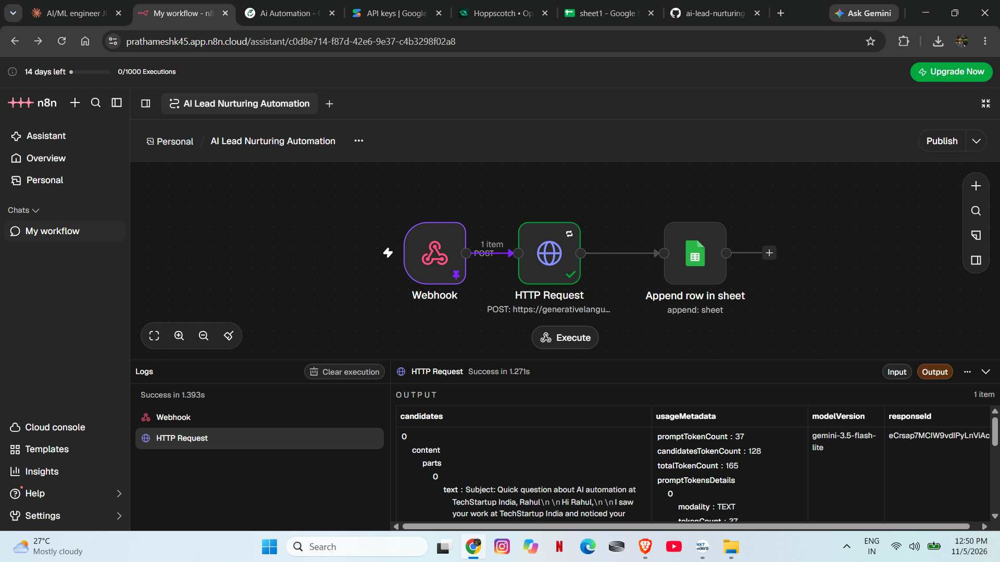

# AI Lead Nurturing Automation

An end-to-end AI-powered lead nurturing workflow built with n8n, Gemini AI, and Google Sheets.

## Workflow

## How It Works
1. **Webhook** receives lead data (name, email, company, interest)
2. **Gemini AI** generates a personalized sales email for each lead
3. **Google Sheets** logs the lead + AI-generated email + timestamp automatically

## Tech Stack
- n8n (workflow automation)
- Google Gemini AI API (email generation)
- Google Sheets (lead logging)
- Webhooks (trigger)

## Results
- Zero manual effort — fully automated lead capture to email generation
- Gemini AI writes personalized emails in under 3 seconds per lead
- All leads logged with timestamp for tracking

## Setup
1. Import `workflow.json` into your n8n instance
2. Add your Gemini API key
3. Connect your Google Sheets account
4. Activate the workflow
